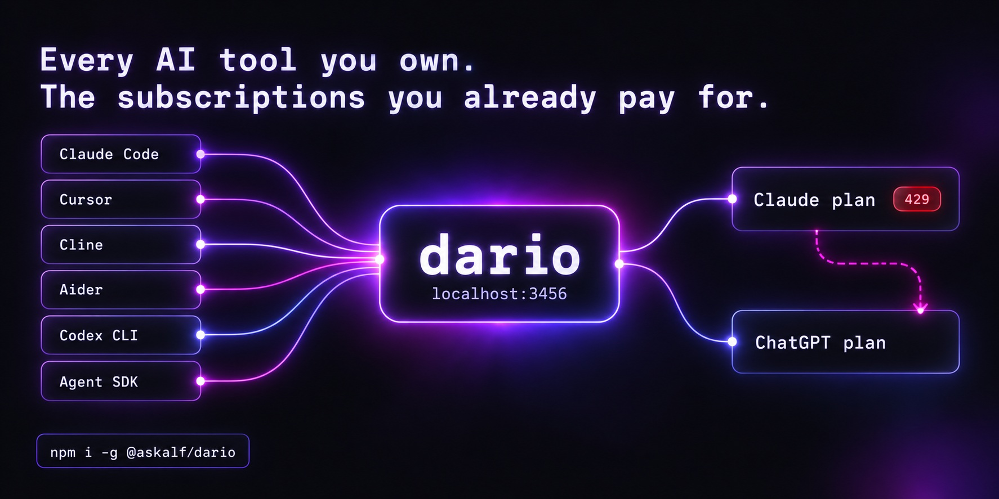
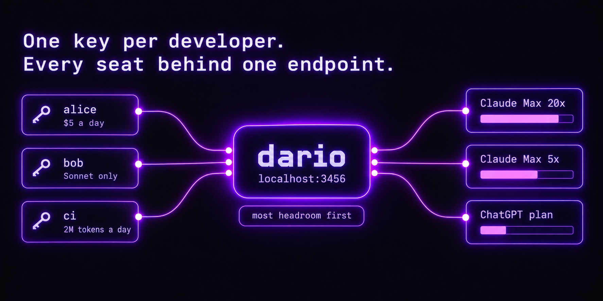
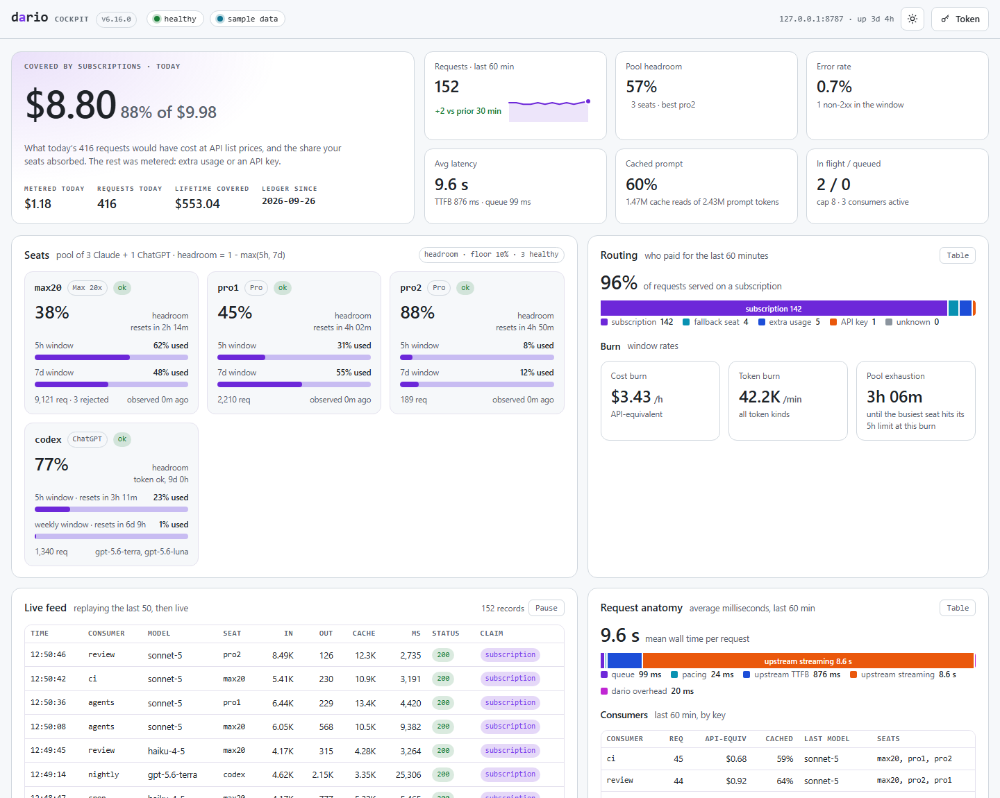
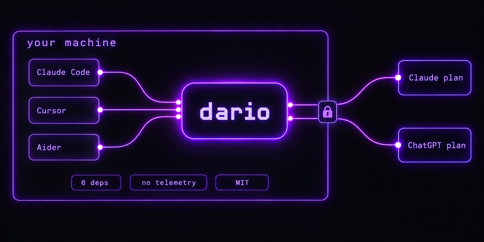

<div align="center">



# `dario`

### Your Claude and ChatGPT subscriptions each live inside their own apps.<br/>dario makes them work **everywhere**, spends the plan before the meter, and keeps the receipt.

<p>
  <a href="https://www.npmjs.com/package/@askalf/dario"></a>
  <a href="https://www.npmjs.com/package/@askalf/dario"></a>
  <a href="https://github.com/askalf/dario/actions/workflows/ci.yml"></a>
  <a href="https://pitlane.askalf.org/"></a>
  <a href="https://scorecard.dev/viewer/?uri=github.com/askalf/dario"></a>
  <a href="https://github.com/askalf/dario/blob/master/LICENSE"></a>
</p>

<p><strong>One local endpoint. Every AI tool you own. Your Claude seats first, your ChatGPT plan and a metered key as the rungs you chain behind them, and a ledger of who paid for what.</strong></p>

<p>In plain words: dario is a proxy you run on your own machine that answers your coding tools' API requests with the plans you already pay for. Each Claude or ChatGPT plan account it holds is a <em>seat</em>.</p>

<sub><code>npm i -g @askalf/dario</code> or <code>brew install askalf/tap/dario</code> · <strong>0</strong> runtime deps · <a href="https://www.npmjs.com/package/@askalf/dario">SLSA-attested</a> every release · nothing phones home · ~45k lines of TypeScript across 88 files · independent, unofficial, third-party (<a href="DISCLAIMER.md">DISCLAIMER.md</a>)</sub>

<sub><a href="#start-in-60-seconds">Start</a> · <a href="#why-people-pick-it">Why dario</a> · <a href="#what-it-does-with-a-request">Routing</a> · <a href="#will-my-account-get-suspended">Risk</a> · <a href="#reference">Reference</a> · <a href="#trust--transparency">Trust</a> · <a href="docs/returning.md">Coming back after a while?</a></sub>

</div>

---

You already pay for Claude,[^plans] for ChatGPT, or both. Each plan spends through its own runtime: Claude Code and the Agent SDK on one side, the ChatGPT app and Codex CLI on the other. Cursor, Aider, Cline, Continue, Zed and your own scripts want a base URL and an API key instead, and an API key is a meter: every token billed **again**, or, on a Max plan since October 2026, a monthly credit balance that stops when it runs out, while the seat's own windows sit idle.

**dario is one local endpoint that puts all of it behind one URL.** Point any Anthropic- or OpenAI-compatible tool at `http://localhost:3456` and you're done. Each request goes to a seat with headroom. Chain the rest with `--pool-fallback` and the other plan takes the request when one hits its window, with a metered backend as the last rung if you add one; without a chain, a drained pool returns its honest 429. The ledger prices every request at API rates and shows what each plan absorbed, in the TUI, the dashboard and `/metrics`.

## Start in 60 seconds

```bash
npm install -g @askalf/dario      # or: brew install askalf/tap/dario
dario login --no-proxy   # your Claude plan (Pro, Max 5x or Max 20x); add --manual for SSH / headless
dario proxy              # leave it running, then point any tool at http://localhost:3456 with key `dario`
```

<picture>
  <source media="(prefers-color-scheme: dark)" srcset=".github/readme/quickstart-dark.svg">
  
</picture>

Anthropic-shaped tools: `export ANTHROPIC_BASE_URL=http://localhost:3456 ANTHROPIC_API_KEY=dario`. OpenAI-shaped tools use `OPENAI_BASE_URL=http://localhost:3456/v1` instead, same key. Every tool that honors those env vars now runs on your subscription.

Check it answers, from a second terminal:

```bash
curl http://localhost:3456/v1/messages \
  -H "Content-Type: application/json" -H "anthropic-version: 2023-06-01" \
  -d '{"model":"claude-fable-5","max_tokens":64,"messages":[{"role":"user","content":"Hello"}]}'
```

Add your ChatGPT plan as a second seat with `dario add altman`.

> **What dario does with your login, plainly.**
> - It uses the Claude login already on this machine: Claude Code's own store (`~/.claude/.credentials.json`, or the macOS keychain) or the one `dario login` saves under `~/.dario/`. It refreshes that token when it expires. If this proxy serves only your ChatGPT plan or an API key, start it with `--no-claude-auth` so it never touches a Claude token that Claude Code here also uses.
> - It sends each Claude request in the shape Claude Code sends, which is what keeps it billing to your plan. `--strict-tls` and `--stealth` go further and match Claude Code's TLS handshake and request timing.
> - It talks only to the backends you set up, and reports nothing anywhere. Claude and ChatGPT traffic goes over HTTPS; a backend you add with `dario backend add` uses whatever its base URL says, so an `http://` URL there is sent unencrypted, key included.
> - Whether this use fits each plan's terms is for you and the provider to decide: [Anthropic's consumer terms](https://www.anthropic.com/legal/consumer-terms), and the terms of your ChatGPT plan. The longer answer: [Will my account get suspended?](docs/account-risk.md)

**Works with:** Claude Code, Cursor, Aider, Cline, Roo Code, Kilo Code, Continue.dev, Zed, OpenHands, OpenClaw, Hermes, Codex CLI, the [Claude Agent SDK](https://www.npmjs.com/package/@anthropic-ai/claude-agent-sdk), the Anthropic and OpenAI SDKs, curl, your own scripts. **[Per-tool setup →](docs/tools.md)**

Prefer Homebrew? `brew install askalf/tap/dario` installs the same npm release through a formula that follows the registry ([tap](https://github.com/askalf/homebrew-tap)); upgrade with `brew upgrade dario`. Prefer Docker? `ghcr.io/askalf/dario:latest`, multi-arch (`amd64` + `arm64`), published from the same workflow as every npm release ([guide](./docs/docker.md)). Something off? `dario doctor` prints one paste-ready health report.

## Why people pick it

- **Every tool, one URL, either plan.** No per-tool keys and no second bill: anything with a base-URL setting runs on the plan you already pay for, your ChatGPT plan behind Claude Code and the Anthropic SDKs, Codex CLI on your Claude plan. [Per-tool setup](docs/tools.md) · [Two plans](docs/two-plans.md)
- **Spends the plan before the meter, and finishes the answer.** Seats with headroom first, then the `--pool-fallback` chain you configure: the other plan on a 429, a metered rung last (your Max plan's API credits through a Console key, or an openai-compat backend). No chain means no substitution: a drained pool returns its honest 429. When one model family is parked but the seat still has room, `--family-fallback=fable=claude-opus-5-5` serves it as another Claude model instead of a 429 ([how](docs/multi-account-pool.md#family-fallback)). A stream that dies mid-answer is completed on the same model first, chain or not. Nothing is swapped silently: every substituted response says so in a header. [Failover](docs/two-plans.md#failover-between-subscriptions)
- **Knows who paid, and stops before it costs you.** A ledger prices every request at API rates and splits it by plan, by key and by model: what the seats absorbed, what went to extra usage or an API key. In the TUI, the dashboard at `/analytics/ui`, `/analytics`, Prometheus `/metrics` and `dario usage` ([analytics](docs/pool-keys-and-analytics.md#what-it-would-have-cost)). The overage guard halts the proxy the moment a response bills outside your subscription ([guardrails](docs/guardrails.md)), and shadow compare benchmarks your own traffic against another model, read with `dario compare` ([shadow compare](docs/two-plans.md#shadow-compare)).
- **Many seats, one key per developer.** Per-model headroom routing, session-sticky prompt cache, in-flight 429 failover across every seat you hold. New conversations go to the seat with the most headroom by default; `--pool-strategy=fill-first` fills seats in alias order, `expiring-first` spends the seat whose weekly window resets soonest, and `headroom-by-plan` counts each seat's headroom by its plan size, shown in the startup banner, `GET /status`, `dario doctor` and `dario accounts list` ([the pool](docs/pool-keys-and-analytics.md)). Named keys carry a preferred seat, a model allowlist and a daily budget; a CI job or a sandboxed agent can be a key with no secret to hold, through `--key-socket` ([key sockets](docs/keys.md#a-key-with-no-secret-key-sockets), [keys](docs/pool-keys-and-analytics.md#one-key-per-developer)).
- **Tracks Claude Code on its own.** Ten unattended watchers run on a schedule: six watch what Claude Code sends, its remote config, how it bills and how it behaves at run time, and four watch the ChatGPT backend, Anthropic's prices, whether the running deploy matches the release, and the watchers themselves. The fix usually ships the same day. [Drift](docs/tracking-claude-code.md)



## What it does with a request

You point every tool at one URL. dario reads each request, decides which plan or backend owns it, and forwards it in that backend's native protocol.

| Client speaks | Model | Routes to | What happens |
|---|---|---|---|
| Anthropic Messages | `claude-*` / `opus` / `sonnet` / `haiku` | Claude pool | OAuth swap + Claude Code template, then `api.anthropic.com` |
| Anthropic Messages | a slug your ChatGPT account lists | Codex engine | Messages→Responses translation, subscription auth |
| Anthropic Messages | `gpt-4o`, `llama-*`, any name no plan lists | Refused | `400` + `x-dario-upstream-rejection: model_unroutable`; reach an API-key backend from this shape with a provider prefix |
| OpenAI Chat | `gpt-*` / `o1-*` / `o3-*` / `o4-*` | OpenAI-compat backend | Auth swap, body forwarded byte-for-byte |
| OpenAI Chat | a slug your ChatGPT account lists | Codex engine | chat/completions→Responses translation, subscription auth |
| OpenAI Chat | `claude-*` | Claude pool | OpenAI→Anthropic translation, then the Claude path |
| Either | `<provider>:<model>` | Forced by prefix | Explicit override |

The tool doesn't know. The backend doesn't know. dario is the seam.

The full Claude lineup, shortcuts, the live model catalog and when a name is refused: [routing.md](docs/routing.md).

## Watch it work

<picture>
  <source media="(prefers-color-scheme: dark)" srcset=".github/readme/dashboard-dark.png">
  
</picture>

Every proxy serves a dashboard at `http://localhost:3456/analytics/ui`: the seats and their headroom, who paid for the last hour, the live request tail, what the ledger says your plans absorbed, the keys and their budgets, and the overage halt with a Resume button. Nothing loads from outside the proxy, light and dark follow your system, every chart has a table view, and it reads on a phone or a wall display. Sample data above, rendered from the shipped page; served by a running proxy it goes live with the analytics token or an API key. [Analytics](docs/analytics.md)

## Will my account get suspended?

The most common question about dario, and it deserves a straight answer: **I can't promise you won't be actioned, and I'd be skeptical of anyone who does.** Only Anthropic decides how it enforces its terms. What I can do is lay out exactly how dario works, so you can weigh the risk yourself instead of taking anyone's word for it.

dario runs entirely on your machine, authenticates as you with your own Claude login, sends requests in the shape the official client sends, and reports nothing anywhere. What it adds is letting tools *other than* Claude Code use that subscription, and whether that falls within your plan's terms is Anthropic's call. **[The full answer](docs/account-risk.md)**, including the [billing-split contingency](docs/guardrails.md#the-billing-split-a-contingency-dario-is-built-for).

## Reference

- **[Per-tool setup](docs/tools.md)**: Codex CLI, Claude Code, Cursor, Cline / Roo / Kilo, Aider, Continue, Zed, OpenHands, OpenClaw, the SDKs, curl, Docker
- **[Routing and the model lineup](docs/routing.md)**
- **[Two plans](docs/two-plans.md)**: your ChatGPT plan on both endpoints, failover between subscriptions, shadow compare
- **[Seats, keys and analytics](docs/pool-keys-and-analytics.md)**: the pool, named keys and budgets, the TUI, the ledger, `/metrics`
- **[How dario tracks Claude Code](docs/tracking-claude-code.md)**: the watchers, their live status, and what they caught
- **[Guardrails](docs/guardrails.md)**: the overage guard and the billing split
- **[Will my account get suspended?](docs/account-risk.md)** · **[Who it's for, and how it compares](docs/who-its-for.md)**
- **[Commands, endpoints and more knobs](docs/cli-and-endpoints.md)** · [every flag](docs/commands.md) · [env vars](docs/configuration.md) · [SDK examples](docs/usage.md)
- **[FAQ](docs/faq.md)** · [Docker](docs/docker.md) · [Coming back after a while?](docs/returning.md)

## Trust & transparency



| Signal | Status |
|---|---|
| Source | **~45k** lines of TypeScript across **88** files. One credential path since v5: the pool. |
| Dependencies | **0 runtime.** Verify: `npm ls --production` |
| Provenance | Every release [SLSA-attested](https://www.npmjs.com/package/@askalf/dario) via GitHub Actions + Sigstore, published with OIDC trusted publishing: no long-lived npm token exists to leak |
| Scanning | [CodeQL](https://github.com/askalf/dario/actions/workflows/codeql.yml) on every push to master, every PR and weekly · [ClusterFuzzLite](./.github/workflows/cflite.yml) fuzzes the SSE translator, the rejection parsers and the cch stamper weekly · the [OpenSSF Scorecard](https://scorecard.dev/viewer/?uri=github.com/askalf/dario) badge above and the [Best Practices](https://www.bestpractices.dev/projects/13638) entry are live |
| Tests | **289 test files** run in parallel by `npm test` on Node 18, 20 and 22; the live e2e / compat / stealth suites have their own entry points. Green on every release |
| Credentials | Your own subscription tokens, never logged, redacted from errors, `0600` on disk in `0700` dirs |
| Network | Binds `127.0.0.1` by default; upstream only to configured backends over HTTPS; hardcoded SSRF allow-list; refuses a non-loopback bind without `DARIO_API_KEY`; refuses cross-origin and DNS-rebound browser requests |
| Telemetry | **None.** No analytics, no tracking, nothing phones home |
| Overhead | Measured in the open on every PR: [`scripts/bench-overhead.mjs`](./scripts/bench-overhead.mjs) runs a real proxy against an instant upstream beside a bare http server serving the same bytes. On loopback dario adds no measurable p50 wall time over that floor; the CPU per request is the number to watch, and the per-request [timing split](./docs/analytics.md#the-timing-split) shows it live |
| This README | CI fails if the line count above drifts from `src/` or a link or anchor here stops resolving ([`check-readme-line-count.mjs`](./scripts/check-readme-line-count.mjs), [`check-readme-links.mjs`](./scripts/check-readme-links.mjs)); the TUI screenshots are rendered from the real TUI and the diagrams are briefed art, not screenshots ([how](./scripts/readme/README.md)) |

```bash
npm audit signatures
npm view @askalf/dario dist.integrity
cd $(npm root -g)/@askalf/dario && npm ls --production
```

Security reports go to **security@askalf.org**, not a public issue: [SECURITY.md](SECURITY.md). API stability commitments (`@stable` / `@experimental` / `@deprecated`, deprecation cycles): [STABILITY.md](STABILITY.md).

## Deep dives

- [Claude Code wire drift](https://askalf.github.io/dario/drift-feed/): every change to what Claude Code sends on the wire, as the template watcher observed it; [RSS](https://askalf.github.io/dario/drift-feed/feed.xml) · [JSON Feed](https://askalf.github.io/dario/drift-feed/feed.json)

- [#1017: Will my account get suspended? What is actually observable, and how to monitor it yourself](https://github.com/askalf/dario/discussions/1017)
- [#68: dario vs LiteLLM / OpenRouter / Kong AI Gateway (when each wins)](https://github.com/askalf/dario/discussions/68)
- [system-prompt-classifier-study.md](./docs/research/system-prompt-classifier-study.md), the measurements behind `--system-prompt=partial`

## Contributing

PRs welcome. Small TypeScript codebase, zero runtime deps. Architecture, file-by-file map and the review bar in [CONTRIBUTING.md](CONTRIBUTING.md); release mechanics in [RELEASING.md](RELEASING.md).

```bash
git clone https://github.com/askalf/dario && cd dario
npm install
npm run dev    # tsx, no build step
npm test       # 289 files in parallel via test/all.test.mjs
npm run e2e    # live proxy + OAuth (needs a working Claude backend)
```

Drift and audit runners, none of them part of `npm test`:

```bash
npm run drift:wire     # compare a live Claude Code capture against the baked template
npm run drift:sdk      # Agent SDK / Stainless pin drift
npm run audit:tui      # drives the real TUI through a fake TTY at 12 geometries
npm run check:overage  # overage-classifier check against live headers
npm run stress         # concurrency / queue behaviour under load
npm run cch:calibrate  # re-derive the billing-tag cch seed for a new Claude Code build
npm run readme:assets  # regenerate the diagrams and TUI screenshots (README + docs/)
```

Two easy ways to help beyond code: **star the repo**, the clearest signal this is useful, and **file drift**: open an issue when a rate-limit header flips or a tool that worked yesterday breaks today, and it gets documented in public alongside the fix. Follow [@ask_alf](https://x.com/ask_alf) for drift bulletins as they land.


Everyone whose issue, pull request or audit shaped dario is credited in [CONTRIBUTORS.md](CONTRIBUTORS.md).

## Disclaimers

**dario is an independent, unofficial, third-party project.** Not affiliated with, endorsed by, or sponsored by Anthropic, OpenAI, or any vendor referenced here. Provided as-is, no warranty. You are solely responsible for compliance with your subscription's terms, the security of your credentials, and the content you send through the proxy. Not for safety-critical, regulated, or production environments without your own review. Full text: [DISCLAIMER.md](DISCLAIMER.md).

## License

MIT. See [LICENSE](LICENSE) and [DISCLAIMER.md](DISCLAIMER.md). The embedded README font is Space Mono under the [SIL Open Font License](./scripts/readme/fonts/OFL.txt).

## Own Your Stack

dario is the routing layer of **[Own Your Stack](https://github.com/askalf)**, open tools for owning your AI infrastructure instead of renting it by the token. One subscription. Your box. Your terms.

- **[dario](https://github.com/askalf/dario)**: own your routing _(you are here)_
- **[browser-bridge](https://github.com/askalf/browser-bridge)**: own your browser
- **[redstamp](https://github.com/askalf/redstamp)**: own your agent security
- **[truecopy](https://github.com/askalf/truecopy)**: own your agent skills · [truecopy-action](https://github.com/askalf/truecopy-action) gates them in CI
- **[cordon](https://github.com/askalf/cordon)**: own your prompts · [pair it with dario](./docs/integrations/cordon.md)
- **[plumbline](https://github.com/askalf/plumbline)**: own your agent oversight
- **[amnesia](https://github.com/askalf/amnesia)**: own your search
- **[ci](https://github.com/askalf/ci)**: own your CI · gating review in CI and [retrying checkouts](https://github.com/askalf/ci/tree/main/actions/checkout-with-retry)
- **[askalf](https://askalf.org)**: own your operation, the AI operation that runs Sprayberry Labs

## Built by Thomas Sprayberry

dario is part of **Own Your Stack**, the open toolkit behind **[Sprayberry Labs](https://sprayberrylabs.com)**, the software studio with one human on staff, run by [askalf](https://askalf.org), the AI operation these tools are part of.

Built in the open, scars included. Follow the build: **[@ask_alf](https://x.com/ask_alf)**

### Sponsors

<!-- sponsors:start -->
dario is funded by its users through [GitHub Sponsors](https://github.com/sponsors/askalf): the live-test seats it is checked against before every release are the biggest line item. Sponsors at $25/month and up are listed here.
<!-- sponsors:end -->

<sub>This block and the thank-you in each release's notes come from <a href="scripts/sponsors.mjs"><code>scripts/sponsors.mjs</code></a>, which reads the public sponsor list; <code>sponsors-readme.yml</code> opens a PR when it changes. Private sponsors are never named.</sub>

### Star history

<picture>
  <source media="(prefers-color-scheme: dark)" srcset="https://api.star-history.com/svg?repos=askalf/dario&type=Date&theme=dark">
  
</picture>

[^plans]: Pro, Max 5x or Max 20x; the current prices are on [claude.com/pricing](https://claude.com/pricing).
